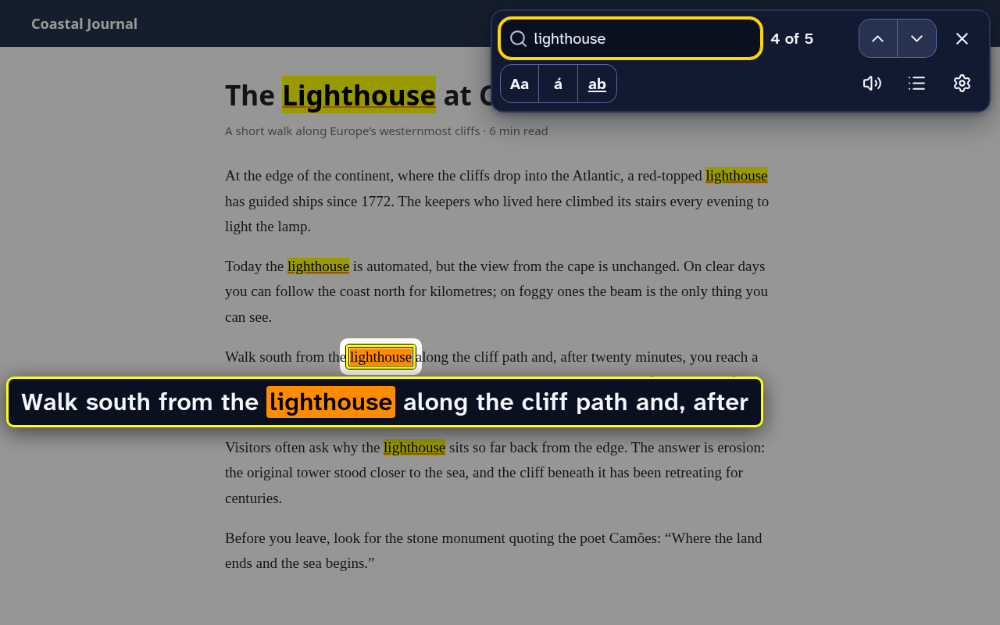
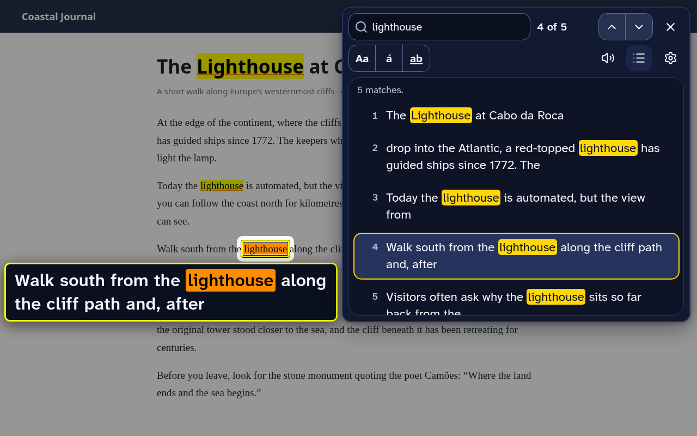

#  Accessible Find in Page

This project is an accessibility-focused browser extension intended to replace the default find-in-page (Ctrl+F) of Chromium-based browsers. I've been diagnosed with Retinitis Pigmentosa, a degenerative eye condition that severely impacts my vision. As a result, I found it challenging to use the default find-in-page feature, which often made it difficult to locate search results on a page. This extension aims to address these challenges with large, customizable highlights and effects that make results easy to see and easy to locate.

## Features

- **Highlights you can see:** your own colors for matches and for the current match, an underline that doesn't rely on color, and a border around the current match.
- **Find the current match quickly:** blinking and a ring that shrinks onto the match, plus a spotlight that dims the rest of the page, guide lines across the screen, and a magnifier that repeats the match in large text right next to it, which you can turn on from the find bar. The find bar steps aside if it would cover the match.
- **All matches at a glance:** a list of every match with the words around it, in large text. Move through it with the arrow keys and the page follows.
- **Read aloud:** hear the sentence around the current match, or have each match read as you move to it, with the browser's built-in voices. Select text on any page and press Alt+R to hear it, even with the find bar closed.
- **Automatic style:** matches on a dark background, on a dark website or in a code block on a light one, take the colors of a profile made for dark backgrounds ("High contrast (dark pages)", or one you choose). The others keep your profile's colors, and your other options stay the same.
- **A big, readable find bar** with adjustable text size (100–300%), light and dark themes, six screen positions, and your recent searches on the arrow keys (kept on your device only).
- **Smarter search:** finds text across links and formatting, ignores accents and case unless you ask (`acao` finds “Ação”), treats curly and straight quotes alike, matches whole words if you want, and searches inside web components. Opens collapsed sections that contain a match, like the browser does.
- **Doesn't break pages:** highlights are painted by the browser (CSS Custom Highlight API) without changing the page, so web apps and editors keep working.
- **Profiles:** save several styles, or start from the built-in high-contrast and colour-blind-friendly ones, which you can change and reset.
- **Keyboard first:** every action has a key (see below). Screen readers hear the match count and the words around the match.
- **Your shortcuts:** the find bar's Alt shortcuts can be changed one by one or all at once (to Ctrl+Alt, Alt+Shift, Ctrl+Shift, or on Linux the Super/Windows logo key), for systems where Alt is taken, like i3 and other window managers.
- **Backups and shared profiles:** save all your settings to a file and restore them, or export a single profile to share it with others.
- **A practice page** to try everything safely, linked from the welcome screen and the settings.

## Installation

### Chrome Web Store

Go to the [Chrome Web Store listing](https://chromewebstore.google.com/detail/accessible-find-in-page/micmgbkeghgbbdmmoieoodhmofafhhlp) and click "Add to Chrome". If you'd like it on another browser's store, please open an issue.

### From source

You need Node.js 22 or newer (`nvm use` picks it up from `.nvmrc`).

1. Clone the repository.
2. Run `npm install`.
3. Run `npm run build`.
4. Open your browser's extensions page (`chrome://extensions`) and turn on **Developer mode**.
5. Click **Load unpacked** and select the `.output/chrome-mv3` folder.

## Usage

After installing, a welcome page opens. Choose how Ctrl+F should work:

- **Ctrl+F on every website (recommended).** Accessible Find opens when you press Ctrl+F on any site. On pages extensions aren't allowed to run on, the browser's own find opens instead, so Ctrl+F always does something. Your browser will ask you to allow access to all websites, because the extension has to be on each page to notice Ctrl+F. It only reads a page when you search it, and your searches never leave your device.
- **Keyboard shortcut only.** No site access needed. The default shortcut is Alt+Shift+F, and you can set it to Ctrl+F on the browser's shortcuts page (`chrome://extensions/shortcuts`). On protected pages you'll get a message explaining why it can't run.

You can also click the toolbar icon. Change everything later from the find bar's quick settings or the full settings page.

| Key | Action |
| --- | --- |
| Enter / Shift+Enter | Next / previous match |
| ↑ / ↓ | Recent searches, or the previous / next match while the list is open |
| Alt+L | Show or hide the list of all matches |
| Alt+R | Read aloud: the current match, or the text you selected (press again to stop) |
| F3, Ctrl+G (Shift for previous) | Next / previous match, even when the page has focus |
| Ctrl+Enter | Open the link (or press the button) at the current match |
| Esc | Close, leaving the current match selected |
| Alt+C / Alt+A / Alt+W | Match case / match accents / whole words only |

The Alt shortcuts can be changed in the settings, under Find bar shortcuts. Alt+R also works on any page without the find bar, with no site access needed: it reads the selected text, or the sentence you last clicked in, or what you typed in a text box (never a password). That one is a browser shortcut, "Read aloud the selected text", so websites can't take the key for themselves; change it on the browser's shortcuts page, like Alt+Shift+F.

### Where it can't run

Browsers don't let any extension run on their own pages (settings, history, the new tab page), on the extension store, or inside the built-in PDF viewer. Local files need **Allow access to file URLs** on the extension's details page. Text inside embedded frames and form fields isn't searched yet.

## Ideas for the future

Not planned yet. If one of these would help you, please open an issue.

- **PDFs:** open them in a built-in PDF viewer (PDF.js) where Accessible Find works, since the browser's own viewer is off-limits to extensions.
- **Find bar next to the match:** an option to move the bar beside the current match, so both stay inside a narrow field of view.
- **Embedded frames and form fields:** search text inside iframes (comments, embedded documents) and inside text boxes.
- **Several terms at once,** each in its own color, for scanning a page for more than one thing.
- **Translations,** starting with Portuguese, and releases for Edge and Firefox (Firefox's own find API even works in its PDF viewer).
- **A true magnifier lens** that enlarges the page itself around the match, images and layout included, instead of a copy of the text.
- **Main content only:** an option to skip matches in menus, headers and footers.
- **Per-site preferences:** remember a profile, text size or bar position for each website.
- **Matches by section:** group the results list under the page's headings, to see where on the page each match is.
- **Find from the right-click menu:** search for the selected text without the keyboard.
- **Choose where the current match lands:** keep it in the center, or the top third, of the screen.
- **Regular expressions** for advanced searches.
- **Text in images:** find words inside pictures and scanned pages, recognized on the device.

## Development

| Command | What it does |
| --- | --- |
| `npm run dev` | Starts a browser with the extension and reloads it on changes |
| `npm run build` | Production build in `.output/chrome-mv3` |
| `npm run zip` | Zip for the Chrome Web Store |
| `npm test` | Unit tests (search engine, settings) |
| `npm run test:e2e` | Builds a test version and runs end-to-end tests in Chromium with Playwright |
| `npm run typecheck` | TypeScript checks |
| `npm run icons` | Regenerates the PNG icons from `assets/brand/*.svg` |
| `npm run store-assets` | Renders the Chrome Web Store screenshots and promo tiles into `store/` |
| `npm run store-video` | Records the demo video, `store/demo.mp4` (needs `ffmpeg`) |

The extension is built with [WXT](https://wxt.dev), React, Tailwind CSS and [shadcn/ui](https://ui.shadcn.com). The design is documented in [docs/BRAND.md](docs/BRAND.md), and the rules for contributors (and AI coding agents) are in [AGENTS.md](AGENTS.md).

How it fits together:

- `src/entrypoints/background.ts`: opens the finder from the shortcut, toolbar button or Ctrl+F. It injects the finder into the page on demand, explains when a page is off-limits, and manages every-website mode.
- `src/lib/search/`: builds a searchable copy of the page's visible text (through shadow DOM, across inline elements) and maps matches back to DOM ranges. Pure functions, unit-tested.
- `src/lib/finder/`: the in-page side. Highlights use the CSS Custom Highlight API; the find bar and the visual effects live in a closed shadow root in the browser's top layer.
- `src/pages/`: the find bar (shown in an iframe, connected to the page by a private message channel), the settings page, the toolbar popup and the practice page.
- `src/lib/settings/`: settings stored in `chrome.storage.sync`, including the upgrade from version 1.

## Contributing

Feel free to contribute! Any help is appreciated, be it code, documentation, or just ideas. If you like the extension, please star this repository and leave a review on the [Chrome Web Store](https://chromewebstore.google.com/detail/accessible-find-in-page/micmgbkeghgbbdmmoieoodhmofafhhlp).

## Privacy

Accessible Find collects nothing and makes no network requests. Pages are searched on your device, and recent searches stay there. See the [privacy policy](PRIVACY.md).

## License

[MIT](LICENSE). Atkinson Hyperlegible Next is used under the [SIL Open Font License](public/fonts/OFL.txt).
